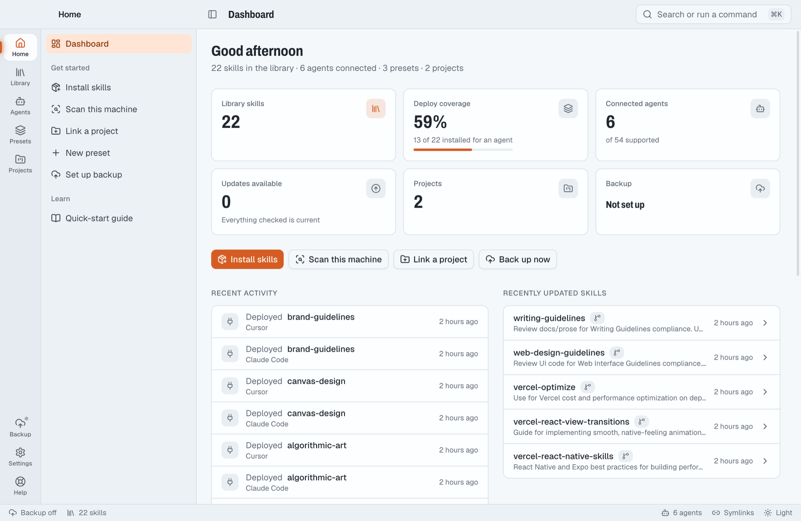
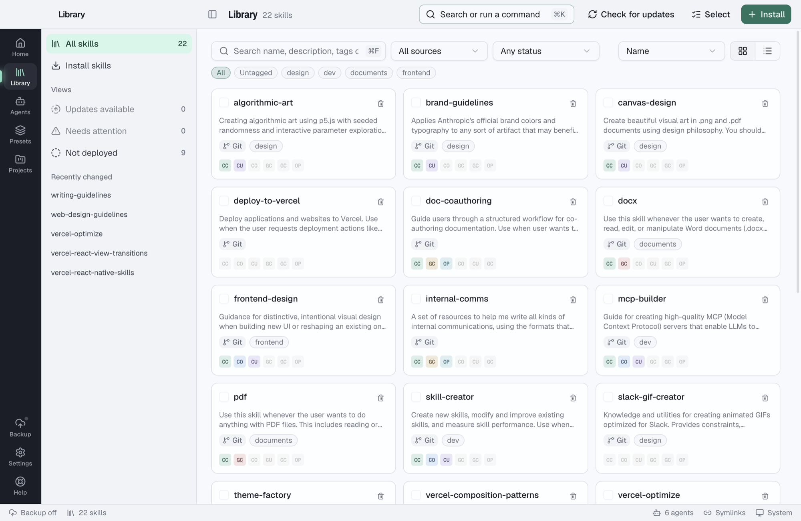
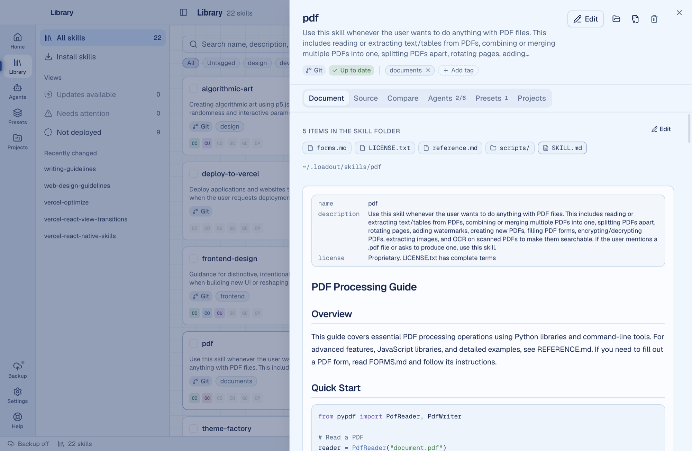
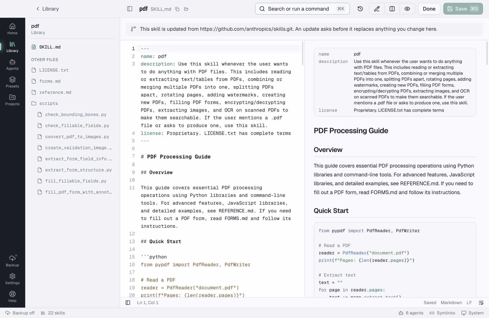
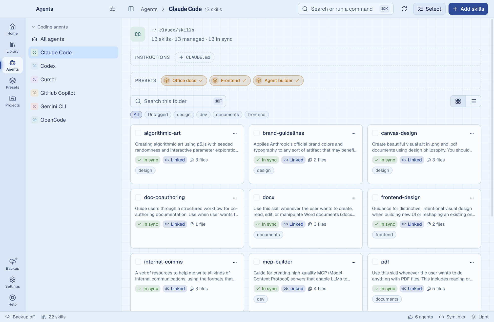
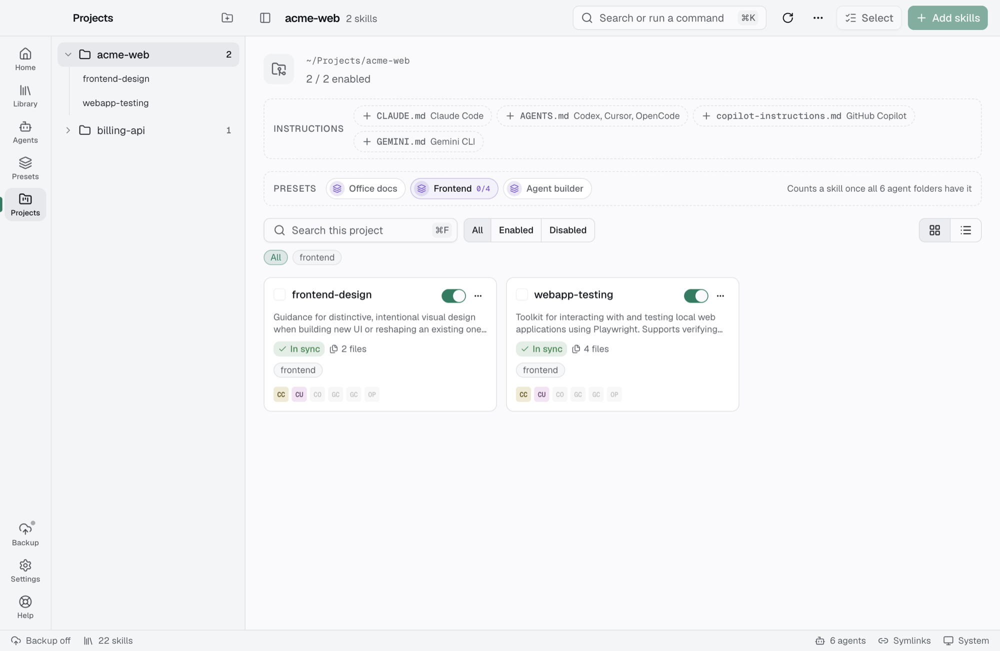
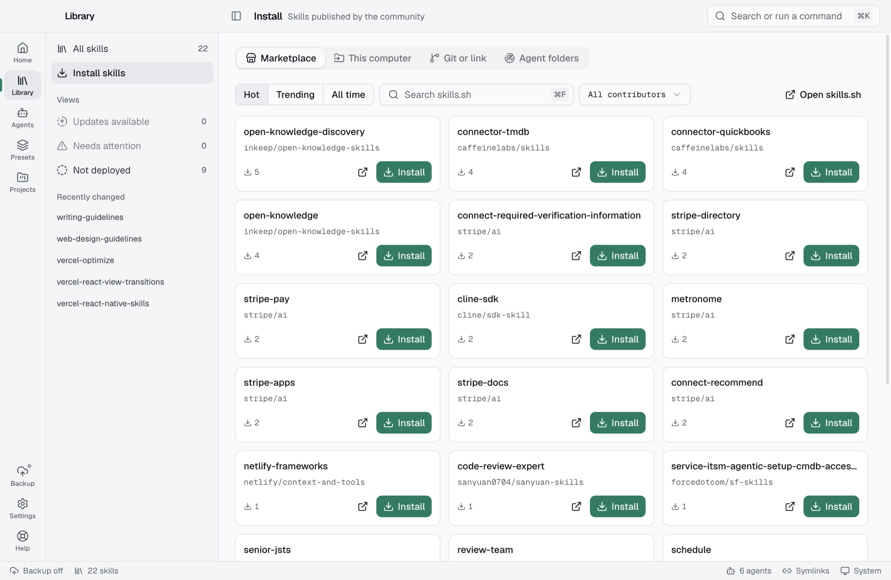
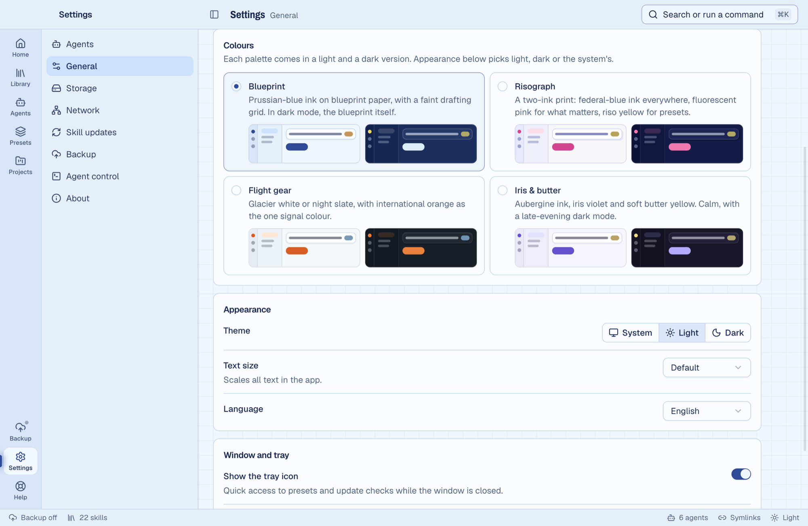
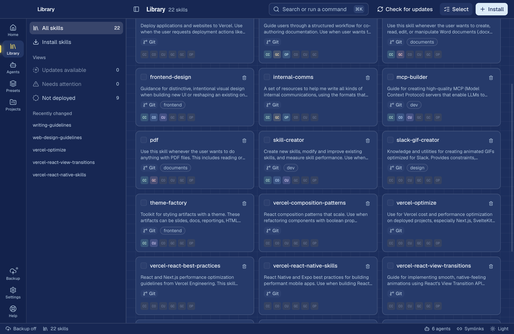

# Loadout

One desktop app to manage AI agent skills across every coding tool.

A skill is a folder with a `SKILL.md`. Loadout keeps every skill in one library
(`~/.loadout`) and deploys it, by symlink or copy, into the skills folder of each agent you
use: Claude Code, Codex, Cursor, Gemini CLI, GitHub Copilot and more than 60 others.



## Install

Download the installer for your system from the
[latest release](https://github.com/antick/loadout/releases/latest).

Loadout runs on macOS and Linux. Windows is not supported for now.

macOS releases from 0.4.1 are signed with an Apple Developer ID certificate and notarized.
[docs/INSTALL.md](docs/INSTALL.md) explains installation on macOS and Linux. After installation,
Loadout checks for updates and offers to download and install them.

## Screenshots

**Library.** Every skill in one place, with its source, tags and the agents it is deployed to.



**A skill.** The rendered `SKILL.md`, its files, where it came from, and switches per agent.



**Editor.** Edit any file of a skill with a live preview. Every save keeps the version it replaced.



**An agent.** Everything in the agent's skills folder, its instruction file, and presets to apply in one click.



**A project.** Skills that live inside a project, per agent, with the project's instruction files.



**Install.** Browse the skills.sh marketplace, or install from a folder, a `.zip`, a Git repository or a link.



**Colours.** Four palettes (Flight gear, Blueprint, Risograph, Iris & butter), each with a light and a dark version. Pick one in Settings or from the status bar; Loadout remembers it.





## Features

- **Library:** one folder for every skill, with search, tags, filters, batch actions and checks against the Agent Skills format.
- **Editor:** edit any file of a skill with a live preview, the last 20 versions kept, and no silent overwrite of changes made on disk.
- **Install:** from a folder, an archive (`.zip`, `.skill`, `.tar`, `.tar.gz`, `.tgz`), a download link, a Git repository (Git itself is optional) or the skills.sh marketplace.
- **Agents:** 69 agents built in and found automatically, plus custom agents and custom folders.
- **Deploying:** give a skill to any agent in one click, by symlink or copy, without ever touching a folder Loadout didn't create.
- **Instruction files:** edit `CLAUDE.md`, `AGENTS.md`, `GEMINI.md` and the rest, globally and per project.
- **Agent workspaces:** see everything in an agent's skills folder, compare it with the library, and adopt skills installed elsewhere.
- **Presets:** named groups of skills you turn on for an agent or a project in one click.
- **Projects:** manage the skills inside each project, per agent, and keep them in step with the library.
- **Skill updates:** check sources on a schedule, see what an update would change, then update one skill or all of them.
- **Backup and sync:** back the library up to a private Git repository and keep several computers in step, with conflicts you resolve.
- **Command line:** a `loadout` CLI with JSON output, and a bundled skill that lets your agents manage skills themselves.
- **App updates:** Loadout updates itself and checks every download against the release checksum.
- **Storage:** everything lives in `~/.loadout`, with sizes, clean-up, a movable library and a remove-everything button.
- **App:** dashboard, command palette (`⌘K`), keyboard shortcuts, four colour palettes in light and dark, tray icon and status bar.

Every feature in detail, current limitations and what still needs testing:
[docs/FEATURES.md](docs/FEATURES.md).

## Run locally

The repository uses [mise](https://mise.jdx.dev) to pin its tools and name its commands.
[mise.toml](mise.toml) holds the exact Node and pnpm versions and the tasks, so you do not
have to remember the package manager.

1. Install [mise](https://mise.jdx.dev/getting-started.html) and Git.

2. Open a terminal in the folder where you cloned this repository, then trust its `mise.toml`
   and install the pinned Node and pnpm:

   ```bash
   mise trust
   mise install
   ```

3. Start the app:

   ```bash
   mise run dev
   ```

   The first run installs the project dependencies. Later runs skip that step until
   `pnpm-lock.yaml` or a `package.json` changes. Then the task builds the CLI and opens the
   Electron desktop app with development reload. Keep the terminal running. The real app
   opens in its own window; you do not need to open a browser or start a separate backend.

4. Stop development with `Ctrl+C` in that terminal. Run `mise run dev` again next time.

Without mise, install Node.js 22.22 or newer, run `corepack enable` to get the pnpm version
pinned in the `packageManager` field of [package.json](package.json), and use the `pnpm`
commands that each task runs (see the `run` lines in `mise.toml`).

No `.env` file or GitHub sign-in is required for basic local use. The installed app keeps its
library at `~/.loadout` or your saved location. `pnpm dev` opens **Loadout Dev**, with a separate
library at `~/.loadout-dev/.loadout` and separate default agent folders under `~/.loadout-dev`.
It does not import your real library or publish over your installed CLI. Use disposable project
copies for testing: a real project you explicitly add can still be modified.

## First use

1. If the first-run backup prompt appears, choose to start fresh or restore an existing backup.
2. Open **Install** and import a local folder/archive, a Git repository, or a marketplace skill.
3. Open **Agents**, select an agent, and use **Add Skills** to deploy skills from the library.
   Installing into the library alone does not deploy a skill to an agent.
4. Use **Presets** to group skills, or add a project to manage its project-local skills.
5. Optionally configure Git backup. A personal access token or Git remote URL works now.
   GitHub device sign-in only works when the app process sees an OAuth App client id in the
   `LOADOUT_GITHUB_CLIENT_ID` environment variable at run time; no build ships one. Start the
   app from a terminal with it set: an app opened from Finder or the Dock does not see it.

## CLI examples

Run these from the repository root:

```bash
mise run cli -- --help
mise run cli -- skills list
mise run cli -- agents list
mise run cli -- skills install /path/to/my-skill
mise run cli -- skills deploy my-skill --agent claude_code --agent codex
mise run cli -- skills status my-skill
```

Replace the example path, skill name and agent keys with your own. The app also publishes
the CLI to `~/.loadout/bin/loadout` when it starts. To let an agent manage skills,
use the agent-control setup card on the Dashboard.

Without the app, install the CLI from npm (Node.js 22.13 or newer):

```bash
pnpm add -g @antick/loadout
loadout --help
```

## Development commands

Run `mise tasks` to list every task. Each task installs the dependencies first when needed.

| Command                  | What it does                                           |
| ------------------------ | ------------------------------------------------------ |
| `mise run dev`           | Build the CLI, then start the app with reload          |
| `mise run check`         | oxlint, oxfmt check, typecheck, all tests              |
| `mise run lint`          | oxlint and the dash check                              |
| `mise run typecheck`     | Typecheck every package                                |
| `mise run test`          | vitest across packages                                 |
| `mise run build`         | Build the CLI and desktop app                          |
| `mise run format`        | Format with oxfmt                                      |
| `mise run package`       | Build installers into `apps/desktop/release`           |
| `mise run cli -- …`      | Run the CLI from source                                |
| `mise run dev:browser`   | Serve the interface in a browser on a seeded test home |
| `mise run test:ui`       | Run the Playwright UI tests                            |
| `mise run test:ui:setup` | Install the Chromium browser the UI tests use (once)   |
| `mise run dev:landing`   | Serve the landing page                                 |

To try the interface in a browser without touching your own library, run
`mise run dev:browser` and open the address it prints. It serves the
renderer on the real core, without Electron, on a temporary home folder seeded with skills,
agents, projects, presets and a backup. Dialogs, the shell and app updates are stand-ins there.
The temporary home is removed when the server stops.

`mise run check` leaves out the UI tests, which click through that browser preview in headless
Chromium with Playwright, each worker on its own seeded home that goes back to the seed before
every test. Run them with `mise run test:ui`, after installing the browser once with
`mise run test:ui:setup`.

## Website

`apps/landing` is the landing page at [loadout.potion.sh](https://loadout.potion.sh), an Astro
static site. `mise run dev:landing` serves it while you work on it, and
`pnpm exec turbo run build --filter=@loadout/landing` builds it. Vercel builds and
serves it from `vercel.json`; links such as where installers are downloaded live in
`apps/landing/src/lib/site.ts`. The agent list on the page comes from `@loadout/shared`, so it
always matches the app. The direct download links are read from the newest release's
`latest.json` at build time; the tests build with `astro build --mode offline`, which skips that
and links to the release page, so they never wait on the network.

## Releases

For every push to `main` and every pull request, GitHub Actions runs the linter, the format check
and the type check once on Linux, the tests on Linux and macOS, and the UI tests on Linux
(`.github/workflows/ci.yml`).

Installers are published as GitHub releases of this repository. The app's update check reads
`latest.json` from the newest published release, and the landing page links there.

`.github/workflows/release.yml` builds macOS (Apple Silicon and Intel, DMG and ZIP) and Linux
(AppImage and DEB, x64 and arm64) installers and the standalone CLI executables. It then writes
`latest.json` (version, and per system the download link, size and SHA-256) with
`apps/desktop/scripts/update-feed.mjs`, and puts everything in a **draft** release.

Signing setup, development separation, installer checks and recovery are documented in
[docs/RELEASING.md](docs/RELEASING.md).

### Cut a release

Every step, from picking the version to checking npm, is in the release skill,
[.agents/skills/release/SKILL.md](.agents/skills/release/SKILL.md). Ask an agent to run it
(`/release`), or follow it by hand.

Publishing the draft puts the release live: running copies of Loadout offer it within six hours,
and a draft is invisible to users and to the update check. Don't mark a release as a
pre-release: the update check only sees the newest full release.

The workflow signs `latest.json` with an ed25519 key (repository secret
`UPDATE_FEED_SIGNING_KEY`) and uploads `latest.json.sig`. From 0.2.1 on, the app ignores a feed
without a valid signature from that key; its public half is `UPDATE_FEED_PUBLIC_KEY` in
`packages/shared/src/constants.ts`. Keep a copy of the private key somewhere safe (a password
manager): losing it means shipping one more release signed with it that carries a new public
key, which is impossible without it.

### The CLI on npm

Publishing a release also publishes the CLI of that tag to npm as `@antick/loadout`
(`.github/workflows/publish-npm.yml`). No npm token is stored: npm trusts that workflow through
trusted publishing. A failed run can be re-run from the Actions tab.

### The landing page

Publishing a stable release starts `.github/workflows/vercel-production.yml`. It checks out
that release's tag, verifies it belongs to `main`, and deploys the website to Vercel production.
The build reads that exact release's installer feed and fails if the expected downloads are
missing. Required repository secrets are `VERCEL_TOKEN`, `VERCEL_ORG_ID`, and
`VERCEL_PROJECT_ID`. Branch pushes and PRs do not deploy production.

## Layout

| Path              | Purpose                                            |
| ----------------- | -------------------------------------------------- |
| `apps/desktop`    | Electron main, preload and the React renderer      |
| `apps/landing`    | Landing page at loadout.potion.sh                  |
| `packages/core`   | All behaviour, plain Node TypeScript (no Electron) |
| `packages/cli`    | The `loadout` command-line tool                    |
| `packages/shared` | Types, API contract, events, settings, formatters  |

See [docs/ARCHITECTURE.md](docs/ARCHITECTURE.md) for the rules and
[docs/FEATURES.md](docs/FEATURES.md) for every feature.

## Planning and specifications

Use the repo-local OpenSpec workflow for future changes. Start with
[the workflow guide](openspec/README.md) and
[existing-product baseline](openspec/baseline.md). Current specs capture core
contracts; the linked source inventory preserves the existing docs and tests,
including areas that still need deeper specification. Run `pnpm run specs:check`
to validate specs and `pnpm run specs list --specs` to browse capabilities.

## License

Loadout is free software under the [GNU General Public License v3.0](LICENSE) (`GPL-3.0-only`).
You may use, change and share it. If you distribute it or a changed version, you must share the
source under the same license.
